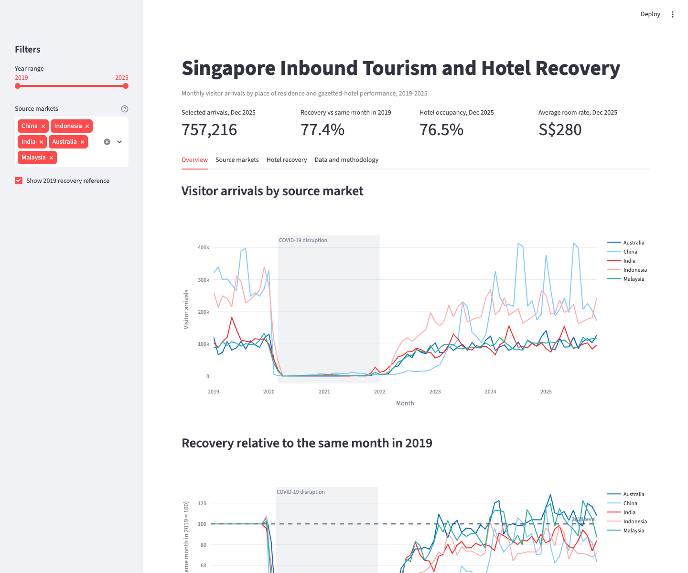

# Singapore Inbound Tourism and Hotel Recovery Dashboard

This DS608 group project examines how Singapore's international visitor arrivals recovered after the COVID-19 disruption and whether the recovery aligned with gazetted-hotel occupancy, room rates and room revenue.



## Research question

How did international visitor arrivals from major source markets recover relative to 2019, and how closely did this recovery align with Singapore's gazetted-hotel performance between 2019 and 2025?

## Dashboard features

- Select a year range from 2019 to 2025.
- Compare multiple source markets.
- View monthly arrivals and a same-month 2019 recovery index.
- Compare 2019 and 2025 source-market totals.
- Examine hotel occupancy, average room rates and room revenue.
- Compare the recovery of total arrivals and hotel room revenue.
- Download filtered visitor and hotel data.

## Data sources

1. [International Visitor Arrivals By Place Of Residence, Monthly](https://data.gov.sg/datasets/d_7e7b2ee60c6ffc962f80fef129cf306e/view), Singapore Department of Statistics. Original source: Singapore Tourism Board.
2. [Hotel Statistics, Monthly](https://data.gov.sg/datasets/d_8e62605f0c1c948702b6ea0fe45242d3/view), Singapore Department of Statistics. Original source: Singapore Tourism Board.

The dataset originally linked during topic exploration is the hotel-statistics table. It is combined with the visitor-arrivals table to support both demand-side and hotel-sector analysis.

## Repository structure

```text
singapore-tourism-dashboard/
├── README.md
├── AI_USAGE.md
├── CONTRIBUTIONS.md
├── app.py
├── requirements.txt
├── data/
│   ├── raw/
│   └── processed/
├── docs/
│   └── PROJECT_PROPOSAL.md
├── src/
│   └── wrangle.py
├── outputs/
│   ├── figures/
│   └── tables/
└── tests/
    └── test_processed_data.py
```

## Setup

Create and activate a virtual environment:

```bash
python3 -m venv .venv
source .venv/bin/activate
```

Install the required libraries:

```bash
pip install -r requirements.txt
```

## Rebuild the processed data

From the repository root, run:

```bash
python src/wrangle.py
```

The script downloads the official API responses, reshapes the wide source tables, validates key fields and writes processed CSV files to `data/processed/`.

## Run the dashboard

```bash
streamlit run app.py
```

## Run the tests

```bash
pytest
```

## Streamlit deployment

Deployment URL: `[add Streamlit Community Cloud URL]`

When deploying, select `app.py` as the main file. The processed CSV files are included so that the public dashboard does not depend on a live API request during each page load.

## Methodology

The visitor-arrival source is hierarchical: it contains an overall total, geographic regions and individual source markets. The wrangling script preserves those levels so that regional totals are not accidentally added to country totals.

The main recovery measure compares each month with the same calendar month in 2019:

```text
Recovery index = monthly value / value in the same month of 2019 × 100
```

An index of 100 means the series returned to its matching 2019 level. A value below 100 means it remained below that level, while a value above 100 means it exceeded the 2019 level.

## Preliminary findings

The processed official data currently show:

- Singapore recorded 16.91 million international visitor arrivals in 2025, equal to 88.5% of the 2019 total of 19.12 million.
- China was the largest individual source market in 2025 with 3.10 million arrivals, followed by Indonesia with 2.44 million.
- Average hotel occupancy was 81.9% in 2025, around 5.0 percentage points below the 2019 average.
- The average room rate was S$273 in 2025, 23.7% above the 2019 average in nominal terms.
- Nominal hotel room revenue reached S$5.37 billion in 2025, 27.9% above 2019 even though total visitor arrivals had not fully returned to the 2019 level.

These are descriptive results. Higher nominal room rates and revenue should not be interpreted as proof that visitor recovery caused hotel performance, and the monetary figures have not been adjusted for inflation.

## Limitations

- Source markets are based on place of residence rather than nationality.
- Hotel indicators refer to gazetted hotels, not every accommodation provider.
- Room rates and room revenue are nominal and are not adjusted for inflation.
- Monthly aggregated data cannot identify individual visitor behaviour or establish causality.
- Recovery can also reflect flight capacity, border policy, exchange rates and major events that are outside the current model.
- The processed project period ends in December 2025 to retain complete calendar years.

## Group work

This project was prepared for DS608 Data Analytics for Economics as a group project. Individual responsibilities are documented in `CONTRIBUTIONS.md`, and the use of generative AI is documented in `AI_USAGE.md`.
